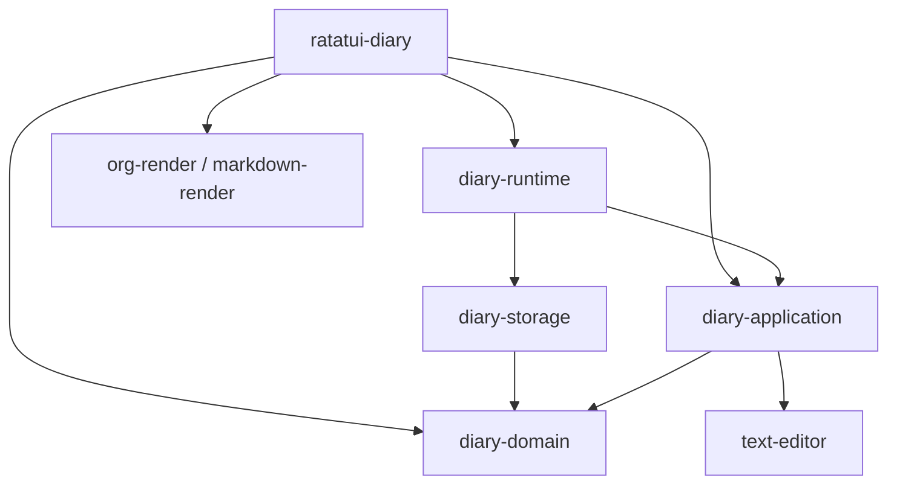

# Ratatui Diary

터미널 기반 다이어리 애플리케이션 (Rust + Ratatui)

## 기능

- 월간 달력 뷰
- Emacs / Helix 키바인딩 전환 (모드리스 / 선택 기반 모달 편집)
- Org-mode (`.org`) 파일 저장, 기존 Markdown (`.md`) 일기 호환
- 다이어리 작성 유무 시각적 표시
- org-bullets 스타일의 실시간 Org 미리보기 (달력 & 에디터)
- Selection 하이라이트
- 검색 매치 하이라이트
- 전체 일기의 로컬 의미 검색 + 문자열 검색, 결과 구절로 바로 이동
- 한국어 / English UI 전환
- 시스템 / 다크 / 라이트 테마
- 컨텍스트 기반 키바인딩 도움말

### 미리보기 기능

- **달력 화면**: 선택된 날짜의 다이어리 내용을 오른쪽에 실시간으로 표시
- **에디터 화면**: 작성 중인 Org-mode 문서를 렌더링하여 오른쪽에 표시
- **화면 분할**: 50:50 레이아웃으로 원본과 미리보기를 동시에 확인
- **Org 제목**: `*`, `**`, `***`, `****` 제목을 깊이에 따라 `◉`, `○`, `✸`, `✿` 불릿으로 표시하며, 다섯 단계부터 반복
- **원문 보존**: 편집·저장 시에는 Org 원문을 유지하고 미리보기에서만 불릿으로 표시
- **기존 Markdown**: `.md` 일기는 기존 Markdown 렌더러로 미리보기

### 전체 일기 검색

달력에서 `/`로 검색 화면을 엽니다. Emacs와 Helix 모두 같은 진입 키를 사용합니다.
`진로에 대한 불안`처럼 상황이나 감정을 입력하면, 정확히 같은 단어가 없어도
관련 문단을 찾습니다. 정확한 표현은 대소문자를 구분하지 않는 문자열 검색으로 함께 찾습니다.

| 키 | 동작 |
|---|---|
| 검색어 입력 → `Enter` | 저장된 전체 일기 검색 |
| `↑` / `↓` / `Ctrl+P` / `Ctrl+N` | 결과 선택 (Helix 결과 모드에서는 `k` / `j`도 가능) |
| 결과에서 `Enter` | 해당 날짜의 일기를 열고 원문의 구절 위치로 이동 |
| `Tab` | 검색어 입력 / 결과 선택 전환 |
| `Esc` / `Ctrl+G` | 달력으로 돌아가기 (Helix에서는 `Ctrl+C`도 가능) |

왼쪽에 날짜·행·열과 결과 종류(`문자열` / `의미 유사`), 오른쪽에 관련 구절과 문맥을 표시합니다.
문자열 일치를 우선하고 의미 유사도로 정렬합니다. 의미 결과는 가장 가까운 문단 최대 20개,
전체 결과는 최대 100개를 표시합니다. 의미 유사 결과는 관련성 제안이며 정확한 일치를 뜻하지 않습니다.
검색 후 원문이 외부에서 바뀌면 구절을 다시 찾아 이동하고, 구절이 삭제되었으면 다시 검색하도록 오류를 표시합니다.

[FastEmbed](https://docs.rs/crate/fastembed/7.1.1)의
[`intfloat/multilingual-e5-small`](https://huggingface.co/intfloat/multilingual-e5-small)을 CPU에서 실행합니다.
첫 TUI 화면을 그린 직후 검색 스레드에서 모델을 미리 로딩합니다. 모델 파일이 없다면
Hugging Face에서 공개 모델(ONNX 약 470 MB와 토크나이저)을 백그라운드로 내려받으므로 인터넷이 필요합니다.
모델은 OS 캐시 디렉터리 아래 `ratatui-diary/models`에 저장하고 다음 실행부터 재사용합니다.
`HF_HOME`을 설정했다면 해당 경로를 사용합니다. 모델이 모두 캐시된 뒤에는 오프라인으로 검색할 수 있습니다.
일기 본문과 검색어를 외부 API로 전송하지 않으며, 검색 작업은 백그라운드에서 수행합니다.
모델 준비나 추론이 실패하면 이유를 표시하고 문자열 검색 결과만 제공합니다.

일기별 임베딩은 `entries/.search-cache/<날짜>.json`에 원문 SHA-256·모델/분할 버전과 함께 저장합니다.
본문과 검색어는 캐시에 중복 저장하지 않습니다. 재시작 후에도 캐시를 재사용하고,
다음 검색에서 변경된 일기만 다시 계산하며 삭제된 일기의 캐시를 정리합니다.
미처리 문단은 여러 일기에 걸쳐 비슷한 길이끼리 최대 16개씩 묶어 추론합니다. 손상·버전 불일치 캐시는 재생성하고,
캐시 읽기·쓰기 실패 시에는 안내를 표시하면서 검색을 계속합니다.
`.search-cache`를 삭제해도 일기 원문은 유지되며 다음 검색에서 캐시를 다시 만듭니다.
미리 로딩이 끝난 뒤 첫 검색은 준비된 모델을 재사용합니다. 로딩 중 검색하면 남은 준비 시간을 기다리며,
로딩 중에도 편집·저장·종료는 가능합니다. 미리 로딩 실패는 실제 검색에서 재시도합니다.
검색을 사용하지 않아도 준비된 모델은 앱이 실행되는 동안 메모리에 유지됩니다. 기존 `.org` / `.md` 저장 규칙을 따르며,
같은 날짜에 두 파일이 있으면 편집기와 동일하게 `.org`를 사용합니다.

기본 테스트는 모델을 다운로드하지 않습니다. 실제 한국어 의미 검색을 검증하려면 다음을 실행합니다.

```bash
cargo test -p diary-runtime real_korean_semantic_search -- --ignored
```

릴리스 단계별 벤치마크와 결과·원문 이동 검증 방법은 [검색 성능 측정](docs/search-performance.md)을 참고하세요.

### Org-mode 작성 형식

새 일기는 Org-mode 형식으로 작성합니다. 줄 맨 앞의 별표 개수가 제목의 깊이이며,
별표 뒤에는 공백을 넣습니다. 들여쓴 `* 항목`은 목록으로 취급하여 원문을 유지합니다.

```org
* 오늘의 기록
오늘 있었던 일을 적습니다.
** 배운 것
- 새로운 내용
- [X] 완료한 일
*** 자세한 메모
본문을 적습니다.
```

미리보기는 제목 불릿과 계층을 표시합니다. 본문의 강조·링크·표 등의 Org 문법은
원문으로 표시하며, 소스·예제·내보내기·주석 블록 내부도 그대로 표시합니다.

## 설치

### 소스에서 설치

```bash
cargo build --release
cargo install --path crates/ratatui-diary
```

### Windows 설치 파일 만들기

`scripts/release.ps1`이 검증 → 릴리스 빌드 → Inno Setup 컴파일을 수행해
`dist/ratatui-diary-<버전>-<아키텍처>-setup.exe`를 만듭니다.

```powershell
# Inno Setup이 없으면 -InstallInno로 winget 자동 설치
./scripts/release.ps1 -InstallInno

# 검증 단계를 건너뛰고 빠르게 패키징만
./scripts/release.ps1 -SkipTest
```

생성된 설치 파일은 다음과 같이 동작합니다.

- `%LOCALAPPDATA%\Programs\Ratatui Diary`에 **사용자 단위**로 설치 (관리자 권한 불필요)
- 설치 마법사에서 **PATH 등록**과 **시작 메뉴 바로가기**를 선택 가능
- 제어판 '앱 및 기능'에서 제거하며, 제거 시 PATH 항목도 함께 정리

| 옵션 | 설명 |
|---|---|
| `-SkipTest` | fmt/clippy/test 검증 생략 |
| `-SkipBuild` | 기존 릴리스 바이너리를 그대로 패키징 |
| `-Version <ver>` | 설치 파일에 표기할 버전 (기본: Cargo.toml) |
| `-Target <triple>` | 크로스 빌드 대상 (기본: 호스트) |
| `-OutDir <path>` | 산출물 디렉터리 (기본: `dist/`) |
| `-InstallInno` | Inno Setup을 winget으로 자동 설치 |

## 사용법

```bash
ratatui-diary
```

### 언어·테마·키바인딩 설정

달력과 에디터 어디서나 `F2`로 설정을 열 수 있습니다.

| 키 | 동작 |
|---|---|
| `Ctrl+N` / `Ctrl+P` / `↑` / `↓` / `Tab` / `Shift+Tab` | 언어·테마·키바인딩 항목 선택 |
| `←` / `→` / `Enter` / `Space` | 선택한 값 변경 |
| `Ctrl+G` / `Esc` / `F2` | 설정 닫기 |

언어는 **한국어 / English**, 테마는 **시스템 / 다크 / 라이트**를 지원합니다.
키바인딩은 **Emacs / Helix** 중에서 선택합니다. 기본값은 기존과 같은 **Emacs**입니다.
`F2` → `키바인딩` 항목 → `←`/`→`로 바꾸면 즉시 적용되고 다음 실행에도 유지됩니다.
Helix 설정 화면에서는 `j/k`로도 항목을 이동할 수 있습니다.
기본값은 한국어와 시스템 테마이며, 시스템 테마는 터미널의 기본 전경·배경색을 따릅니다.
변경은 즉시 적용되고 자동 저장되어 다음 실행에서도 복원됩니다. 일기 본문과 편집 상태는 유지됩니다.

설정 파일은 OS 설정 디렉터리 아래 `ratatui-diary/settings.conf`에 저장됩니다.
Linux에서는 `${XDG_CONFIG_HOME:-~/.config}/ratatui-diary/settings.conf`를 사용합니다.
읽기·저장 오류는 팝업으로 표시하며, 잘못된 파일을 읽으면 기본 설정으로 시작합니다.

```ini
language=ko
theme=system
keybindings=emacs
```

`language`는 `ko` 또는 `en`, `theme`는 `system`, `dark`, `light`,
`keybindings`는 `emacs` 또는 `helix`를 사용합니다. 이전 설정 파일에 `keybindings`가 없으면 Emacs를 사용합니다.

### 달력 화면 (Emacs)

날짜·주 이동으로 월이나 연도 경계를 넘으면 달력도 선택 날짜의 달로 자동 전환됩니다.
월·연도 이동 시 같은 일자를 유지하며, 해당 일자가 없으면 그 달의 마지막 날을 선택합니다.

| 키 | 동작 |
|---|---|
| `Ctrl+B` / `Ctrl+F` | 이전/다음 날짜 이동 |
| `Ctrl+P` / `Ctrl+N` | 이전/다음 주 이동 |
| `Alt+N` / `Alt+P` | 다음/이전 달 이동 |
| `Alt+]` / `Alt+[` | 다음/이전 연도 이동 |
| `PageUp` / `PageDown` | 이전/다음 달 이동 (두 키맵 공통) |
| `Ctrl+PageUp` / `Ctrl+PageDown` | 이전/다음 연도 이동 (두 키맵 공통) |
| `Enter` | 다이어리 작성/편집 |
| `Ctrl+X → Ctrl+C` | 저장 후 종료 |
| `Ctrl+G` | 접두키 명령 취소 |

### 에디터 화면 (Emacs 스타일)

Emacs 스타일 모드리스 에디터로, 별도의 모드 전환 없이 항상 문자 입력이 가능합니다.
`Ctrl+`/`Alt+` 조합으로 명령을 실행합니다. Emacs 표기에서 `C-`는 Ctrl,
`M-`는 Alt이며, `C-x C-s`는 Ctrl+X를 누른 뒤 Ctrl+S를 누르는 순차 입력입니다.

**커서 이동:**

| 키 | 동작 |
|---|---|
| `Ctrl+F` / `Ctrl+B` | 오른쪽/왼쪽 한 글자 이동, 줄 경계도 통과 |
| `Ctrl+N` / `Ctrl+P` | 아래/위 한 줄 이동 |
| `Ctrl+A` / `Ctrl+E` | 줄 시작/줄 끝 이동 |
| `Alt+F` / `Alt+B` | 다음 단어 끝/이전 단어 시작 이동, 빈 줄과 구두점도 통과 |
| `Alt+<` / `Alt+>` | 문서 시작/문서 끝 이동 |
| 방향키 / `Home` / `End` | 글자·줄 이동 / 줄 시작·끝 |
| `Ctrl+Home` / `Ctrl+End` | 문서 시작/끝 |

단어는 유니코드 영숫자(한글 포함)와 밑줄을 기준으로 구분합니다.

**편집:**

| 키 | 동작 |
|---|---|
| 문자 입력 | 커서 위치에 삽입 (항상 가능) |
| `Enter` / `Ctrl+J` / `Ctrl+M` | 새 줄 |
| `Backspace` / `Ctrl+H` | 커서 앞 문자 삭제 |
| `Ctrl+D` | 커서 뒤 문자 삭제 |
| `Ctrl+O` | 커서 위치에 새 줄 열기 (open-line) |
| `Ctrl+K` | 커서~줄 끝 삭제 (kill-line) |
| `Alt+D` | 다음 단어 끝까지 잘라내기 (kill-word) |
| `Alt+Backspace` | 이전 단어 시작까지 잘라내기 (backward-kill-word) |

**Selection & 클립보드:**

| 키 | 동작 |
|---|---|
| `Ctrl+Space` / `Ctrl+@` | 마크 설정 (Selection 토글) |
| `Ctrl+W` | 선택 영역 잘라내기 |
| `Alt+W` | 선택 영역 복사 |
| `Ctrl+Y` | 현재 커서 위치에 붙여넣기 (yank), 여러 줄도 지원 |
| `Ctrl+G` | 마크 해제 |

**Undo/Redo:**

| 키 | 동작 |
|---|---|
| `Ctrl+/` / `Ctrl+_` / `Ctrl+X → u` | 실행취소 |
| `Ctrl+Shift+Z` / `Ctrl+?` | 다시실행 |

일반 문자 입력·삭제·줄 열기도 실행취소할 수 있습니다.

**증분 검색:**

| 키 | 동작 |
|---|---|
| `Ctrl+S` / `Ctrl+R` | 정방향/역방향 검색 시작 |
| 문자 입력 | 입력하는 즉시 검색 결과로 이동 |
| `Ctrl+S` / `Ctrl+R` (검색 중) | 다음/이전 매치로 이동, 문서 끝에서 순환 |
| `Backspace` / `Ctrl+H` | 검색어 한 글자 삭제 후 즉시 재검색 |
| `Enter` | 현재 결과 확정, 정방향은 검색어 끝·역방향은 시작에 커서 위치 |
| `Ctrl+G` / `Esc` | 검색 취소, 검색을 시작한 커서 위치로 복원 |

새 검색에서 검색어를 입력하기 전에 `Ctrl+S` 또는 `Ctrl+R`을 한 번 더 누르면
직전 확정 검색어를 다시 사용합니다. 검색은 대소문자를 구분합니다.

**Ctrl+X 프리픽스 명령:**

| 키 | 동작 |
|---|---|
| `Ctrl+X` | 프리픽스 모드 진입 |
| `Ctrl+X → Ctrl+S` / `Ctrl+X → s` | 현재 일기 저장 |
| `Ctrl+X → k` | 현재 일기를 저장하고 달력으로 돌아가기 |
| `Ctrl+X → Ctrl+C` | 변경 내용을 저장하고 앱 종료 (달력에서도 사용 가능) |
| `Ctrl+X → u` | 실행취소 |
| `Ctrl+G` / `Esc` | 프리픽스 명령 취소 |

저장에 실패하면 오류를 표시하고 편집 내용을 유지하며, 종료하거나 달력으로 이동하지 않습니다.
알 수 없는 접두키 조합이나 지원하지 않는 Ctrl/Alt 키는 본문에 삽입하지 않습니다.

**기타:**

| 키 | 동작 |
|---|---|
| `Ctrl+G` | 진행 중인 명령·검색·선택 취소, 설정·오류 창 닫기 |
| `Ctrl+Q` | 저장 후 종료 (기존 호환 별칭) |
| `Ctrl+Z` | 실행취소 (기존 호환 별칭) |

`Ctrl+X → Ctrl+C`는 이제 앱 종료이며, 이전의 달력 복귀 동작은 `Ctrl+X → k`로 옮겼습니다.
이 앱은 단일 내부 클립보드를 사용하며 Emacs의 전체 kill-ring·미니버퍼·매크로는 제공하지 않습니다.

**시각적 피드백:**
- Selection 영역: 회색 배경으로 하이라이트
- 검색 매치: 노란색 배경으로 표시
- 현재 매치: 밝은 노란색 + 굵게
- 서브모드 표시: 상태바에 `-- C-x --`, `검색: 패턴` 표시

### 에디터 화면 (Helix)

[Helix 공식 키맵](https://docs.helix-editor.com/keymap.html)의 단일 선택 편집 동작을 따릅니다.
Helix를 선택하면 **Normal** 모드로 시작하며, 모드와 접두키 도움말을 상태바에 표시합니다.
키맵 전환은 본문·실행취소 기록을 보존하고 진행 중인 접두키를 초기화합니다.
Helix 전환 시 기존 선택 범위를 Normal 모드의 커서 표시 방식에 맞춥니다.

**모드와 선택:**

| 키 | 동작 |
|---|---|
| `i` / `a` | 선택 앞/뒤에서 Insert 시작 |
| `I` / `A` | 줄 시작/끝에서 Insert 시작 |
| `o` / `O` | 선택 아래/위에 새 줄을 열고 Insert 시작 |
| `v` | Select 모드 전환: 이후 이동은 선택 영역 확장 |
| `Esc` | Normal 복귀·접두키 취소, 검색 중에는 원래 선택과 커서 복원 |
| `;` / `Alt+;` | 현재 커서로 선택 축소 / 선택 방향 뒤집기 |
| `%` | 문서 전체 선택 |
| `x` / `X` | 줄 전체 선택·반복 시 다음 줄 확장 / 현재 선택을 줄 경계까지 확장 |

Helix는 **선택 → 편집** 순서입니다. 예를 들어 `w d`는 다음 단어 시작까지 선택한 텍스트를 삭제하고,
`w c`는 선택을 지운 뒤 Insert로 들어갑니다. Vim의 `d w` 방식과 다릅니다.

**이동과 편집:**

| 키 | 동작 |
|---|---|
| `h/j/k/l`, 방향키 | 한 글자·한 줄 이동 |
| `w/b/e` | 다음 단어 시작 / 이전 단어 시작 / 다음 단어 끝까지 선택 |
| `W/B/E` | 공백으로 구분한 WORD 단위 선택 |
| `g g`, `g e`, `g h`, `g l`, `g s` | 문서 시작 / 마지막 줄 / 줄 시작 / 줄 끝 / 첫 공백 아닌 글자 |
| `3 g g` / `3 G` | 3번째 줄 이동 |
| `f/F`, `t/T` + 문자 | 다음/이전 문자까지 또는 그 직전까지 선택, 줄 경계도 통과 |
| `Alt+.` | 직전 `f/F/t/T` 이동 반복 (`;`는 반복 이동 키가 아님) |
| `Ctrl+F/B`, `PageDown/Up` | 실제 편집 영역 높이만큼 페이지 이동 |
| `Ctrl+D/U` | 반 페이지 이동 |
| `d` / `c` | 선택 삭제·복사 / 선택 삭제 후 Insert |
| `y` / `p` / `P` | 선택 복사 / 선택 뒤·앞에 붙여넣기 |
| `r` + 문자 / `R` | 선택의 각 글자를 해당 문자로 교체 / 복사한 텍스트로 교체 |
| `u` / `U` | 실행취소 / 다시실행 |
| `~` / `` ` `` | 선택의 대소문자 전환 / 소문자 변환 |

`3l`, `2w`, `3x`처럼 숫자를 앞에 붙일 수 있습니다. 반복 편집의 크기를 제한하기 위해 숫자는 최대 10,000까지 받습니다.
Insert에서 입력한 내용은 `Esc`까지 한 번의 실행취소로 묶으며, `Ctrl+S`로 중간 실행취소 지점을 만들 수 있습니다.
Insert의 `Ctrl+W`/`Alt+Backspace`, `Alt+D`/`Alt+Delete`, `Ctrl+U/K`, `Ctrl+H/D`, `Ctrl+J`와 방향키도 지원합니다.
새 줄은 현재 줄의 공백 들여쓰기를 이어받습니다. 편집 영역은 커서 위치를 따라 스크롤합니다.

**검색과 파일 명령:**

| 키 | 동작 |
|---|---|
| `/` / `?` | 정방향/역방향 정규식 검색 |
| `n` / `N` (Normal) | 검색 방향의 다음/이전 결과 선택 |
| `*` | 현재 선택을 검색어로 사용, 단어 경계는 자동 처리 |
| `Enter` / `Esc` | 검색 확정 / 검색 취소와 이전 검색어·선택 복원 |
| `:w` / `:write` | 현재 일기 저장 |
| `:q` / `:quit` | 종료, 미저장 변경이 있으면 중단 |
| `:q!` | 변경 내용을 저장하지 않고 명시적으로 종료 |
| `:wq` / `:x` | 저장 성공 후 종료 |
| `:bc` / `:buffer-close` | 달력으로 돌아가기, 미저장 변경이 있으면 중단 |
| `Space f` | 현재 일기를 저장하고 일기 선택 화면(달력) 열기 |

명령·검색 입력에서는 방향키, `Home/End`, `Ctrl+A/E/B/F`, `Ctrl+U/K/W`, Backspace/Delete로 입력을 편집하고
`Esc` 또는 `Ctrl+C`로 취소합니다. `Space f`는 이 앱의 날짜 기반 파일 선택에 맞춘 동작입니다.
검색은 Helix의 기본 smart-case 방식입니다. 검색어에 대문자가 없으면 대소문자를 구분하지 않고,
대문자가 있으면 구분합니다. 마지막 결과 뒤에서는 처음으로 순환합니다.
`Space w`를 저장에 배정하지 않으며, `q`도 종료 키로 사용하지 않습니다.
달력에서는 `h/j/k/l`로 날짜, `H/L`로 월, `{/}`로 연도를 이동하고 `Enter`로 편집합니다. 종료는 `:q`입니다.
`PageUp/PageDown`으로 월, `Ctrl+PageUp/Ctrl+PageDown`으로 연도를 이동할 수도 있습니다.

지원 범위는 **한 개의 선택 영역과 일기 파일**입니다. 다중 커서·다중 선택(`s/S/C`, Select 모드의 `n/N`), 레지스터 선택, 매크로,
삽입 반복(`.`), 들여쓰기·줄 합치기 명령, `m` 텍스트 객체, 분할 창, LSP·Tree-sitter·시스템 클립보드 명령은 구현하지 않습니다.
지원하지 않는 키는 본문에 삽입하거나 다른 명령으로 재해석하지 않습니다.

## 데이터 저장

다이어리는 OS의 로컬 데이터 디렉토리 아래 `ratatui-diary/entries/`에 저장됩니다.
Linux의 기본 경로는 `~/.local/share/ratatui-diary/entries/`입니다.

새 일기의 파일명 형식은 `YYYY-MM-DD.org`입니다.
기존 `YYYY-MM-DD.md` 일기는 변환하지 않고 같은 파일에서 계속 열고 편집·저장합니다.
같은 날짜의 `.org`와 `.md`가 모두 있으면 `.org`를 우선해서 표시·저장하며 `.md`는 보존합니다.
날짜의 일기를 삭제하면 두 형식의 파일을 모두 삭제합니다.

### 파일 보호와 입력 제한

일기와 설정은 같은 디렉터리의 임시 파일에 기록·동기화한 뒤 원자적으로 교체합니다.
쓰기나 교체에 실패하면 오류를 표시하고 편집 내용을 유지합니다. 일기 열기에 실패하면 달력으로
돌아가며 이전 버퍼의 내용과 날짜를 보존합니다.

일기·설정 파일과 직접 사용하는 저장 디렉터리의 심볼릭 링크·Windows reparse point,
파이프 등 일반 파일이 아닌 항목은 거부합니다. 저장 위치와 그 상위 디렉터리는 신뢰할 수 있는
개인 디렉터리를 사용해야 합니다. 같은 계정의 다른 프로세스가 상위 디렉터리를 동시에 바꾸는
공격까지 격리하는 파일 시스템 sandbox는 제공하지 않습니다.

일기 파일은 UTF-8 기준 **4MiB**, 설정 파일은 **64KiB**까지 읽습니다. 초과 파일은 오류로 표시하며,
4MiB를 넘는 일기는 저장도 거부하므로 파일을 분리하거나 크기를 줄여야 합니다.
Unix에서 새 디렉터리는 `0700`, 저장 파일은 `0600` 권한으로 생성하며 Windows에서는 부모 디렉터리의
ACL을 따릅니다. 기존 상위 디렉터리의 권한은 자동 변경하지 않습니다.

릴리스 스크립트는 실행별 고유 스테이징 디렉터리를 생성합니다. 생성된 스테이징 디렉터리는
빌드 결과 확인을 위해 출력 디렉터리에 남습니다.

## 유니코드 지원

- 한글(CJK) 문자의 전각(2칸) 너비를 올바르게 처리
- `unicode-width` 크레이트를 사용하여 커서 위치를 정확하게 계산
- 멀티바이트 문자(UTF-8)에 대한 바이트/문자 인덱스 변환 지원

## 아키텍처

Cargo workspace 기반 모노레포이며, Clean Architecture의 의존성 방향을 따릅니다.
안쪽의 도메인·애플리케이션은 파일 시스템, OS 경로, 시스템 시계, Ratatui, Crossterm에 의존하지 않습니다.

| crate | 책임 |
|---|---|
| `diary-domain` | 일기 내용·형식, 달력 규칙, 언어·테마·키맵 설정, 설정 문자열 파싱·직렬화 |
| `text-editor` | 날짜·UI·저장소와 무관한 텍스트 편집 엔진 |
| `diary-application` | 앱 상태, Emacs/Helix 입력 정책, 상태 전이, 부수효과 요청과 결과 처리 |
| `diary-storage` | 일기·설정 파일 입출력과 OS 저장 경로 |
| `diary-runtime` | 시작 시 시계·설정·목록 로드, 부수효과 명령 실행과 결과 전달 |
| `org-render`, `markdown-render` | 문서를 Ratatui 미리보기 텍스트로 변환 |
| `ratatui-diary` | 실행 진입점, 터미널 이벤트 변환, 화면·색상·커서 렌더링 |



순수한 상태 전이는 `Model + Msg → Option<Command>` 형태입니다. `Model`의 변경은 입력에만 의존하며
파일을 읽거나 시간을 조회하지 않습니다. `Runtime`이 명령을 실행하고 성공·실패 메시지를 돌려줍니다.
저장 후 종료·달력 복귀 여부는 애플리케이션이 결정하므로, 저장 실패 시 편집 상태가 보존됩니다.
별도 저장소 trait 대신 기존 `Command`/`Msg`를 입출력과의 interface로 사용합니다.

미리보기 파일은 시작·날짜 이동·달력 복귀 시 로드하고, 뷰는 로드된 상태만 표시합니다.
외부 편집기의 파일 변경은 해당 날짜를 다시 선택할 때 반영됩니다. 렌더링 반복 중 파일을 읽지 않습니다.
현재 날짜는 실행부에서 주입하며 달력의 오늘 표시도 이 값을 사용합니다.

내부 Rust interface는 다음과 같이 변경되었습니다. 실행 명령과 사용자 데이터 경로·파일 형식은 유지됩니다.

```rust
// 순수한 초기화: 테스트에서는 고정된 날짜와 목록을 주입
let mut model = diary_application::Model::new(today, entries);
let mut runtime = diary_runtime::Runtime::new(storage, settings_path);
if let Some(command) = diary_application::update(&mut model, message) {
    runtime.execute(command, &mut model);
}
```

설정 파일 입출력은 `diary_storage::settings::{path, load, save}`, 순수한 문자열 변환은
`diary_domain::settings::Settings::{parse, serialize}`에서 담당합니다.
터미널 키는 `ratatui_diary::input::translate`를 거쳐 애플리케이션의 논리 입력 값으로 변환됩니다.

## 개발

```bash
# 테스트 실행
cargo test --workspace

# 입출력·터미널 의존성 없이 순수 로직만 테스트
cargo test -p diary-domain -p diary-application

# 전체 포맷과 운영 코드 정적 검사
cargo fmt --all -- --check
cargo clippy --workspace -- -D warnings -D clippy::unwrap_used

# 개발 모드 실행
cargo run
```

### 성능 측정

```bash
cargo bench -p ratatui-diary --bench hotpaths
```

벤치마크는 준비·정리 시간을 제외하고, 워밍업 1회 뒤 7회 측정한 중앙값을 출력합니다.
다음은 Windows x86_64의 동일한 최적화 빌드 조건에서 측정한 변경 전후 결과입니다.
검색·붙여넣기·이동은 상태 전이만, 렌더링은 120×32 `TestBackend`의 그리기만 측정합니다.
실제 터미널 출력과 파일 I/O는 포함하지 않으며, 시간은 실행 환경에 따라 달라집니다.

| 시나리오 | 변경 전 | 변경 후 |
|---|---:|---:|
| 한글 한 줄에서 검색 결과 30,000개 찾기 | 43.600ms | 0.454ms |
| Emacs `C-y`로 한글 30,000자 삽입 | 680.608ms | 0.077ms |
| 2,000줄·검색 결과 60,000개인 문서 렌더링 | 21.522ms | 1.458ms |
| 같은 문서에서 Helix 커서 이동 20회 | 10.953ms | 1.755ms |

검색은 앞부분의 문자 수를 다시 세지 않고 순서대로 누적합니다. 붙여넣기는 블록 단위로 처리해
다음 줄들을 한 번만 이동하며, Unicode 위치·겹치는 검색 결과·실행취소 동작을 유지합니다.
검색 하이라이트는 정렬된 검색 결과를 이진 탐색하고, Helix 이동은 문서 길이 계산을 위한 문자열 복사를 생략합니다.
화면은 입력·창 크기·날짜 변경 시 갱신하므로 대기 중에 미리보기를 반복 생성하지 않습니다.

## 라이선스

MIT
